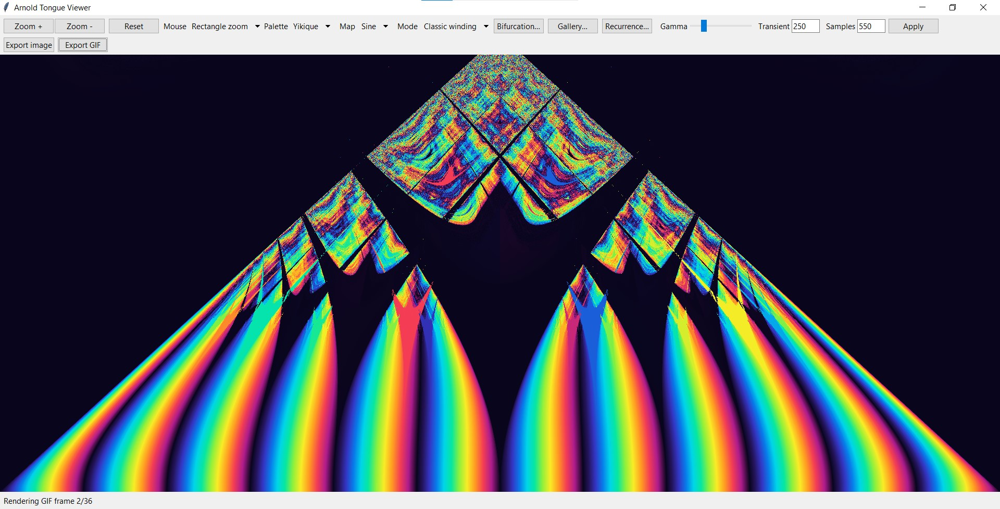
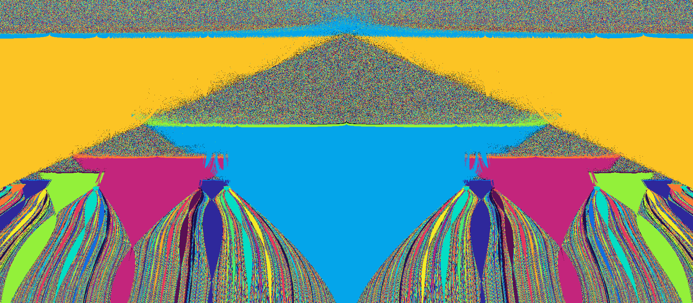

[](https://github.com/SKR-35/Arnold-Tongue-Viewer/actions/workflows/ci.yml)

# Arnold Tongue Viewer

**An interactive Python desktop explorer for circle maps, mode locking, winding numbers, recurrence structures and bifurcation diagrams.**

Arnold Tongue Viewer turns the parameter space of periodically forced circle maps into an explorable image. Move across resonance regions, zoom into fine structures, compare forcing functions and export still images or animated GIFs. The application combines numerical computation with a lightweight Tkinter interface.

The viewer is designed for mathematical exploration, computational art and learning about nonlinear dynamical systems. Its visualizations are calculated from iterated maps rather than generated from static image assets.

## Application Preview

The Arnold Tongue Viewer provides an interactive desktop interface for exploring nonlinear dynamics through numerical visualization.



*Interactive visualization of the circle map using the Classic Winding mode.*

## Visualization Showcase

The viewer reveals intricate structures in the parameter space of nonlinear circle maps. Different palettes highlight the geometry of mode-locking regions and the surrounding dynamical behavior.



*Parameter-space visualization rendered with the Yikique color palette.*

## Highlights

- **Interactive parameter-plane viewer:** mouse-wheel zoom, rectangle selection, drag-to-pan navigation, zoom controls and reset.
- **Three forcing families:** Sine, Triangle and Sawtooth.
- **Multiple mathematical views:** mode locking, rotation number, classic winding, Poincaré recurrence and recurrence order.
- **Bifurcation explorer:** inspect phase behavior as coupling varies at a selected driving frequency.
- **Animated exports:** camera motion, palette transitions, negative-image pulses and GIF export.
- **Reference gallery:** 16 presets covering resonance close-ups, high-coupling regions, winding patterns and recurrence structures.
- **Color customization:** 17 palettes, including Yikique, turbo, viridis, magma, inferno and plasma.
- **Accelerated computation:** Numba-backed kernels for supported numerical workloads.
- **Reproducible workflow:** explicit numerical settings, deterministic random-walk animation seeds, automated tests and GitHub Actions CI.

## Gallery

The application opens with **Rainbow Showcase**, a colorful *Sine / Classic winding* visualization using the Yikique palette. Open **Gallery…** to switch between curated parameter-space configurations.

The gallery includes the following explorations:

| Preset | Exploration |
| --- | --- |
| 01 · Circle-map bifurcation | Coupling-dependent phase behavior |
| 02 · recur-circ | Sine-map first-return structure |
| 03 · recur-tri | Triangle-map first-return structure |
| 04 · recur-tri-q | Discrete return-step visualization |
| 05 · wind-circ | Classic winding bands |
| 06 · Rainbow Showcase | Colorful winding overview; default startup |
| 07 · Rainbow winding close-up | Central winding structures |
| 08 · Triangle recurrence detail | Higher-resolution return structure |
| 09 · Sine recurrence close-up | Fine first-return features |
| 10 · Sawtooth winding bands | Discontinuous forcing patterns |
| 11 · Resonance microscope | Narrow resonance window |
| 12 · Triangle return mosaic | Discrete return classes |
| 13 · Sawtooth return strata | Sawtooth return-time bands |
| 14 · High-coupling kaleidoscope | Winding at elevated coupling |
| 15 · Rational island scan | Return-step patterns near resonances |
| 16 · Sawtooth spectral bands | High-coupling sawtooth winding |

These presets are **exploratory visualizations**, not pixel-for-pixel reproductions of external reference artwork. Their numerical definitions and coloring may differ from those of other circle-map galleries.

## Mathematical model

The standard sine circle map is represented by the lift

\[
F(\theta) = \theta + \Omega - \frac{K}{2\pi}\sin(2\pi\theta),
\]

with the phase wrapped modulo one during iteration:

\[
\theta_{n+1} = F(\theta_n) \pmod 1.
\]

Here, **Ω** is the driving frequency parameter, **K** is the coupling strength and **θ** is the phase. The same \(K/(2\pi)\) scaling convention is used for the Triangle and Sawtooth forcing families. These piecewise forcing functions have different smoothness properties from the sine map, so their parameter-space structures need not match.

### Rotation number and winding

The viewer estimates the average unwrapped phase displacement after discarding a configurable transient:

\[
\rho \approx \frac{1}{N}\sum_{n=1}^{N}\bigl(F(\theta_n)-\theta_n\bigr).
\]

Regions where the rotation number locks to a rational ratio form the familiar **Arnold tongues**. Finite iteration counts produce approximations: a colored region or apparent rational value is not, by itself, a mathematical proof of locking.

### Recurrence visualizations

The recurrence modes examine returns of iterated phases near a reference phase using configurable tolerances and search limits. **Poincaré recurrence** visualizes observed return times. **Recurrence order q** visualizes discrete observed return-step classes; it should not be interpreted as a certified minimal orbit period.

### Bifurcation diagram

The separate bifurcation window plots sampled asymptotic phases against coupling **K** at a fixed **Ω**. Its controls allow changes to the frequency, coupling range, transient and sample count. The window supports image export and an animated sweep of Ω.

## Installation

### Requirements

- Python **3.12 or newer**
- [uv](https://docs.astral.sh/uv/)
- A desktop environment with Tkinter support

Clone the repository and install the project dependencies:

```bash
git clone https://github.com/SKR-35/Arnold-Tongue-Viewer.git
cd Arnold-Tongue-Viewer
uv sync
```

Launch the application:

```bash
uv run python -m arnold_tongue_viewer.app
```

The package uses NumPy, Pillow, Matplotlib and Numba. The first accelerated calculation may take longer while Numba compiles a kernel. Subsequent calculations can benefit from cached compilation.

**Tkinter note:** Tkinter is supplied by the Python installation rather than the project's package dependencies. If the application cannot import `tkinter`, install or enable Tk support for your Python environment.

## Using the viewer

1. **Choose a map:** select Sine, Triangle or Sawtooth from the **Map** menu.
2. **Choose a visualization:** select a compatible option from **Mode**.
3. **Explore the parameter plane:** scroll to zoom, choose rectangle zoom for precise selections or switch to pan mode to move the viewport.
4. **Adjust numerical accuracy:** change **Transient** and **Samples**, then click **Apply**.
5. **Customize the appearance:** choose a palette and adjust **Gamma** where the selected rendering mode supports it.
6. **Open specialized explorers:** use **Bifurcation…**, **Gallery…** or **Recurrence…**.
7. **Export the result:** save a still image or create an animated GIF.

The status bar displays the current Ω and K ranges. Some rendering modes have restrictions; for example, the dedicated **Mode locking** implementation currently supports the Sine family.

### Understanding the controls

| Control | Purpose |
| --- | --- |
| Map | Selects the forcing function |
| Mode | Selects the numerical observable and visualization |
| Palette | Changes the color mapping |
| Gamma | Adjusts color-value distribution in supported modes |
| Transient | Number of initial iterations discarded |
| Samples | Number of subsequent iterations used for an estimate |
| Rectangle zoom | Selects a precise region to magnify |
| Bifurcation | Opens the coupling-versus-phase explorer |
| Gallery | Loads curated visualization settings |
| Recurrence | Configures return tolerance and search settings |

Higher transient and sample counts can improve numerical resolution, but they also increase computation time. Recurrence searches have their own iteration budget and tolerance.

## Image and GIF export

### Still images

Use **Export image** to save the current visualization. Suggested filenames encode the relevant visualization parameters to make exported results easier to identify and reproduce.

### Parameter-space animations

Use **Export GIF** to configure a sequence of calculated viewports. Available camera motions include:

- **Smooth Zoom:** progressively magnifies the selected region.
- **Orbit:** moves the viewport center around a curved path while zooming.
- **Pendulum:** adds side-to-side movement.
- **Random Walk:** follows a seeded, reproducible camera path.

Color effects include **Static**, **Palette Pulse** and **Negative Pulse**. Palette Pulse blends between the primary palette and a second palette. Negative Pulse periodically transitions toward inverted colors.

The animation dialog also controls frame count, final zoom factor and random seed. Each frame is rendered from its own mathematical viewport before color effects are applied; the motion is not a simple enlargement of a previously exported bitmap.

### Bifurcation animations

The bifurcation explorer provides a separate GIF export that sweeps **Ω** across a selected interval. This reveals how the phase distribution changes as the driving parameter varies.

**Performance:** high-resolution GIFs with many frames can require substantial computation. Start with modest frame counts and image dimensions when testing a new region.

## Architecture

The code is organized as a Python package under `src/arnold_tongue_viewer/`:

| Module | Responsibility |
| --- | --- |
| `app.py` | Application entry point |
| `gui.py` | Tkinter interface, navigation and export controls |
| `core.py` | Sine circle-map calculations and rotation estimates |
| `map_families.py` | Sine, Triangle and Sawtooth forcing |
| `locking.py` | Mode-locking classification and coloring |
| `explorer.py` | Winding and recurrence visualizations |
| `bifurcation.py` | Bifurcation computation and animation |
| `animation.py` | Viewport trajectories and GIF generation |
| `render.py` | Parameter-plane rendering and viewport model |
| `palettes.py` | Color palettes and gamma mapping |
| `export.py` | Image export and suggested filenames |
| `reference_gallery.py` | Curated exploration presets |

The numerical computation is separate from the Tkinter interface, enabling unit tests without launching the desktop application.

## Development and quality checks

Install development dependencies:

```bash
uv sync --group dev
```

Run the test suite:

```bash
uv run pytest -q
```

Check linting and formatting:

```bash
uv run ruff check .
uv run ruff format --check .
```

GitHub Actions runs dependency installation, Ruff checks and pytest on pushes and pull requests.

## Numerical interpretation and limitations

This software is intended for exploration and visualization rather than rigorous computer-assisted proof.

- Rotation numbers are estimated using finite trajectories and finite sampling windows.
- Apparent mode locking can depend on numerical tolerances, iteration counts and resolution.
- Recurrence-order colors indicate observed return steps, not certified periodic-orbit orders.
- High-coupling dynamics can produce intricate structures that require careful numerical interpretation.
- The forcing families differ mathematically; identical settings need not yield comparable visual patterns.
- Palette choices and gamma affect appearance, not the underlying dynamical system.

For reproducible comparisons, record the map family, observable, parameter bounds, transient, sample count, recurrence settings and palette.

## References

- [Arnold tongue — Wikipedia](https://en.wikipedia.org/wiki/Arnold_tongue)
- [Circle-map art gallery — Linas Vepstas](https://linas.org/art-gallery/circle-map/circle-map.html)

These references provide mathematical background and visual inspiration. The project's renderers are independent implementations; resemblance does not imply algorithmic equivalence.

## License

Licensed under the **Apache License, Version 2.0**.

## Contributing

Bug reports, reproducible numerical examples and improvements to the rendering pipeline are welcome through GitHub issues and pull requests. When reporting a rendering issue, include the map family, visualization mode, parameter bounds, numerical settings and steps needed to reproduce the result.